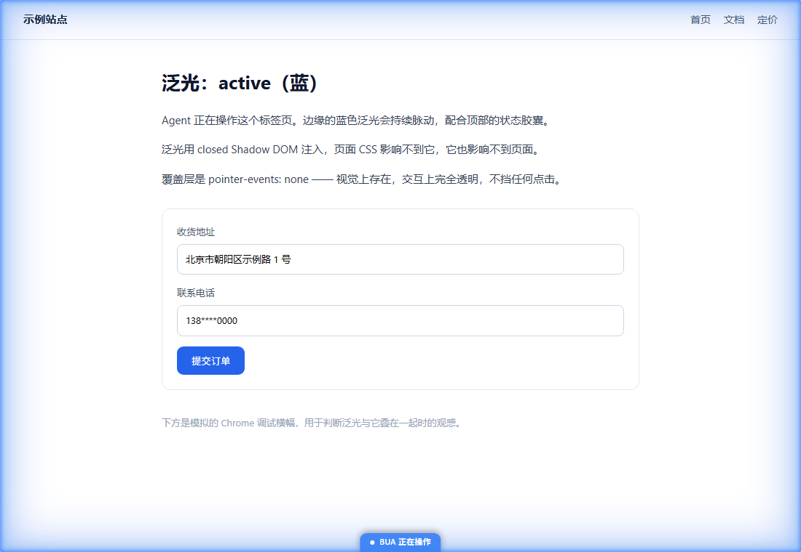
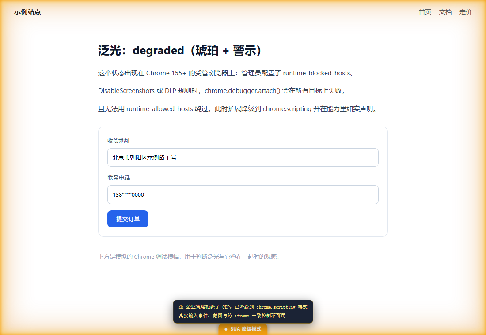

# BUA — Browser Use Agent

**让任意 Agent 操作用户真实浏览器的通用能力层。**

> Playwright 让你操作「一个浏览器」。BUA 让你操作「用户的**那个**浏览器」。

---

> Playwright 让你操作「一个浏览器」。BUA 让你操作「用户的**那个**浏览器」。

BUA 是一个 Chrome MV3 扩展 + 本地桥 + 精简 SDK，把「控制浏览器」做成一个中立、可被**任何** agent 复用的能力：DSH、Claude Code、Codex、自研脚本都能连同一个桥。

- **用真实浏览器** —— 真实标签页、真实 Cookie、真实登录态。不用重新登录，不用过风控
- **不用重启浏览器** —— 通过扩展内的 `chrome.debugger` 从**内部** attach
- **不绑定任何 Agent** —— 协议中立，API 形状对齐 Codex 以便迁移

## 为什么需要它

现有的浏览器 agent 方案分三类，各自有一个硬伤：

| 路线 | 代表 | 硬伤 |
|---|---|---|
| 独立浏览器自动化 | Playwright / Puppeteer | **没有用户的登录态**。要重新登录、过风控、扫验证码 |
| 直连 CDP 端口 | `--remote-debugging-port` + Puppeteer | **CDP 端口无认证** —— 本机任意进程连上 `127.0.0.1:<port>` 就等于拿到浏览器完全控制权。且 Chrome 136+ 对默认 user-data-dir **静默失效该端口**，144+ 每次连接都要用户点批准 |
| 浏览器扩展 | Codex 的 ChatGPT 扩展、Browser MCP | 方案本身对，但要么闭源、要么绑定单一 agent，**且现有的本地桥普遍没有鉴权** |

**BUA 走扩展路线，并且把两个公认的缺口补上。**

### 差异一：零本地端口

扩展通过 `chrome.debugger` 从**内部** attach —— 天然拥有用户真实标签页、Cookie、登录态，**无需重启浏览器**，也**不需要在 `127.0.0.1` 上开任何 CDP 端口**。

这意味着「本机进程连上调试端口即接管浏览器」这个风险面**根本不存在**。

> 注：BUA 自己的桥仍然监听本地端口（扩展要连它），但它讲的是 **BUA 协议而非 CDP** —— 能力受 BUA 方法面约束。而且本设计**不做鉴权**（见下方安全模型）。

### 差异二：如实的能力声明，而非假定

BUA 不限制 agent、不签发凭据（见下方安全模型），因此不需要「授权层级」。取而代之的是**如实的能力声明**：桥在握手时返回 `capabilities`，声明这个后端**此刻实际能**做什么。

最有价值的场景是**降级**：企业策略（Chrome 155+）拒绝 `chrome.debugger.attach()` 时，扩展改用 `chrome.scripting` 兜底，并把 `cdp` 报为 `false`。agent 应据此降级，而不是失败。

⭐ **这个降级模式现有项目无一实现** —— 企业环境下它们直接不可用。

### 差异三：不抢用户进程

调研中发现的行业反面教材：Browser MCP（7.2k★）开 `9009` 端口无任何鉴权，`killProcessOnPort(9009)` 会**强杀用户机器上占用该端口的任意进程**，新连接还会直接踢掉旧连接。

BUA 明确**不做**这三件事（kill 端口占用进程 / 踢旧连接 / 无鉴权）。端口被占用就报错让用户换，多客户端各自独立会话。

## 状态

🚧 **早期设计阶段（M0 完成）**。API 面已定型，`protocol` 包已实现并测试，扩展与桥未开始。

已完成的可行性验证：
- ✅ CDP 全链路实测通过（读 DOM / 点击 / 真实鼠标与键盘事件注入 / 截图）
- ✅ 抠出 OpenAI Codex 浏览器扩展的完整 API 面作为对齐基准（22 接口 / 152 声明 / 67 类型，共 219 条，逐条核对一致）
- ✅ 竞品调研（Playwright MCP / chrome-devtools-mcp / Stagehand / Browser MCP / open-browser-use / WebMCP）
- ✅ 上架政策调研 —— **结论：`chrome.debugger` 是 Google 官方明文允许的远程执行例外，能过审**


## 文档

| 文档 | 内容 |
|---|---|
| [docs/design.md](docs/design.md) | **设计主文档**：架构、API 对齐映射、安全模型、路线图、未决问题 |
| [docs/protocol.md](docs/protocol.md) | 桥协议：JSON-RPC 方法、类型、错误码 |
| [research/](research/) | 调研材料：竞品、上架政策、Codex API 参考 |

## 架构一览

```
┌──────────────┐   MCP / HTTP / SDK   ┌──────────────┐   WebSocket    ┌──────────────┐
│  任意 Agent   │ ───────────────────▶ │  bua-server  │ ◀────────────▶ │  BUA 扩展     │
│              │ ◀─────────────────── │  (本地桥)     │ 127.0.0.1 + Host│  (MV3)       │
└──────────────┘                      └──────────────┘                └──────┬───────┘
                                                                             │ chrome.*
                                                                             ▼
                                                                  用户真实浏览器
```

```
packages/
├── protocol/    # 唯一真源：类型、方法名、schema
├── extension/   # Chrome MV3 扩展（控制节点）—— 边缘泛光指示状态
├── server/      # 本地桥：ws 服务端 + Host 校验 + 会话路由 + 审计
├── sdk/         # agent 侧 SDK（对齐 Codex 形状）
├── mcp/         # MCP 服务器 —— 任意 MCP agent 接入（DSH / Claude Code / Codex）
└── dsh-bundle/  # DSH 组合包（零代码，只含配置）—— 让 DSH 一键装上
```

## 接入方式

三种，按你的 agent 选。

**① DSH** —— 装组合包，工具以 `mcp__bua__*` 出现：

```
把 D:\bua\packages\dsh-bundle 这个组合包安装到当前 profile
```

细节见 [dsh-bundle 文档](packages/dsh-bundle/README.md)。

**② 任何 MCP 客户端** —— 直接配 stdio：

```json
{ "mcpServers": { "bua": {
    "command": "node",
    "args": ["<仓库>/packages/mcp/dist/stdio.js"],
    "env": { "BUA_BRIDGE_PORT": "17432" } } } }
```

细节见 [mcp 文档](packages/mcp/README.md)。

**③ 自己写代码** —— 用 SDK：

```ts
import { connect } from '@bua/sdk';
const agent = await connect({ port: 17432, client: { name: 'my-agent' } });
```

细节见 [sdk 文档](packages/sdk/README.md)。

### MCP 工具一览

共 **14 个**，工具名前缀 `mcp__bua__`。读取优先，变更型一律要求 `targetDescription`：

| 类别 | 工具 |
|---|---|
| 后端 | `browser_info` |
| 标签 | `tabs_list` `tab_open` `tab_info` `tab_navigate` `tab_close` |
| 观察 | `tab_dom_snapshot` `tab_text` `tab_screenshot` `tab_evaluate` |
| 交互 | `tab_click` `tab_fill` `tab_type` `tab_click_at` |


## API 速览

```ts
import { connect } from '@bua/sdk';

const agent = await connect({ port: 17432, client: { name: 'my-agent' } });
const browser = await agent.browsers.getDefault();

// 接管用户**已经打开**的标签 —— 真实登录态，不用重新登录
const [userTab] = await browser.user.openTabs();
const tab = await browser.user.claimTab(userTab);

// 默认优先用语义定位
await tab.playwright.getByRole('button', { name: '提交' })
  .click({ targetDescription: '提交按钮' });

console.log(await tab.text());
```

**所有变更型方法必须传 `targetDescription`** —— 人类可读的意图描述，例如 `"结算按钮（￥299）"`。因为**坐标无法让人判断风险，描述可以**。它进审计日志，是用户在无鉴权模型下唯一的追溯手段。

同一个标签提供**四层操作抽象**，按任务精度选：

| 层 | 入口 | 何时用 |
|---|---|---|
| Playwright | `tab.playwright` | **默认首选**，语义定位 |
| AX | `tab.ax` | 视觉确认与结构化读取 |
| DomCUA | `tab.domCua` | 坐标不稳时的折中 |
| CUA | `tab.cua` | 无语义元素时的兜底（真实鼠标事件） |

详见 [SDK 文档](packages/sdk/README.md)。

## 测试

### 本地扩展开发

运行 `pnpm --filter @bua/extension dev`，然后在当前 Chrome 的
`chrome://extensions` 开启开发者模式，加载 `packages/extension/dist`。
开发模式监听扩展源码、页面、manifest 和协议源码，保存后自动重新构建，
并生成内联 source map，方便在 DevTools 中调试 TypeScript。

选项页改动后刷新页面；Popup 改动后关闭再打开；后台脚本或 manifest
改动后点击扩展卡片的“重新加载”。文件监听不会自动重启扩展。
按 Ctrl+C 停止监听。发布时仍使用 `pnpm --filter @bua/extension build`，
生成不含开发 source map 的产物。

```sh
pnpm -r --filter "./packages/**" run test            # 147 项单元 / 集成 / 协议测试
pnpm --filter @bua/extension run test:e2e            # 13 项真实浏览器端到端
```

| 包 | 测试数 | 覆盖 |
|---|---|---|
| `protocol` | 24 | 风险分级、占位符解析、错误码 |
| `server` | 44 | Host/Origin 拦截（含绕过尝试）、协议、路由、审计 |
| `sdk` | 20 | 请求形状、CDP 返回值解包、错误映射、事件、心跳、真桥接线 |
| `mcp` | 21 | 真 MCP 协议（工具目录 / schema / 调用 / 错误分派）+ **real stdio 子进程 E2E** |
| `extension` | 27 | 覆盖层行为（隔离的 vm 上下文）、演示产物 |
| `dsh-bundle` | 11 | 组合包配置自检（含「args 路径真实存在」与「端口与扩展一致」） |
| **实机 E2E** | **13** | Chrome for Testing 加载真实扩展 + 真实 CDP |


## 边缘泛光

扩展不做侧边栏。当某个标签处于 agent 控制下时，页面四周会亮起一圈**边缘泛光** —— 一个不占页面面积、不拦截点击的氛围信号。

| 状态 | 外观 |
|---|---|
| `active` | 蓝色脉动 + 底部「BUA 正在操作」 |
| `degraded` | **琥珀色** + 警示行（例如企业策略拒绝 CDP，已降级） |
| `paused` | 中性灰，不脉动 |





**为什么需要它**：Chrome 的调试横幅是 Chrome 的，无法隐藏，而且**用户一关就终止会话**。泛光是 BUA 自己的，能在横幅之外独立表达状态 —— 尤其是「已降级，CDP 不可用」这种横幅不会告诉你的事。

实现要点：注入用 `closed` Shadow DOM，页面 CSS 影响不到它、它也影响不到页面；`pointer-events: none` 保证不挡任何点击；泛光由三层 inset 加一层外溢 box-shadow 构成，让光晕溢出视口边缘；用 `Page.addScriptToEvaluateOnNewDocument` 注册，因此**导航后自动恢复**。

完整操作流水不在页面上，而在工具栏弹窗里按需查看。

## 安全模型：本机即信任

> **⚠️ BUA 不做鉴权。任何能访问本机回环地址的进程都能驱动你的浏览器。**
>
> 这是**刻意的取舍**，不是疏漏。目标是「让任意 agent 都能用浏览器」—— 引入配对凭据会让每个 agent 都要集成授权流程，门槛就回来了。
>
> 风险由**第一次安装时的引导页如实告知**，用户主动确认后才启用。见 [docs/design.md §4](docs/design.md)。

**保留的防线**：

| 措施 | 作用 |
|---|---|
| 硬绑 `127.0.0.1` | **挡住远程访问** —— 这是唯一真正的边界 |
| `Host` 头校验 | 挡 **DNS rebinding**（恶意页面解析域名到回环去连本地桥）。不限制 agent |
| 审计轨迹 | 记 `sessionId` + `targetDescription` + 变更前状态。无鉴权之下这是用户唯一的追溯手段 |
| `{{secret:name}}` 占位符 | 凭据在扩展侧替换，**真实值不进 agent 上下文** |
| 页面内容标记不可信 | 防提示注入 |

**明确不做**：

| ❌ | 原因 |
|---|---|
| token / 证书 | 与「不限制 agent」冲突 |
| `Origin` 校验 | 会排除非扩展客户端 = 限制 agent |
| `killProcessOnPort` | **强杀用户进程不可接受**（Browser MCP 的反面教材） |
| 踢旧连接 | 破坏多 agent 并发前提 |

**未来演进**：可在引导页签发证书（生成密钥对，握手携带签名）。协议已是「一条 hello 消息」，加字段即可，无需改动其他层。

## 明确不做

- ❌ 独立浏览器自动化（那是 Playwright 的地盘）
- ❌ 内置模型推理（BUA 不是 agent，是 agent 的手）
- ❌ 账号密码托管
- ❌ 验证码绕过
- ❌ 本地桥鉴权（见上方安全模型）

## 许可

MIT

---

**API 形状对齐** [OpenAI Codex 浏览器扩展](https://openai.com/)，无代码复用。感谢其在浏览器 agent 接口设计上的探索。
